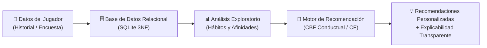
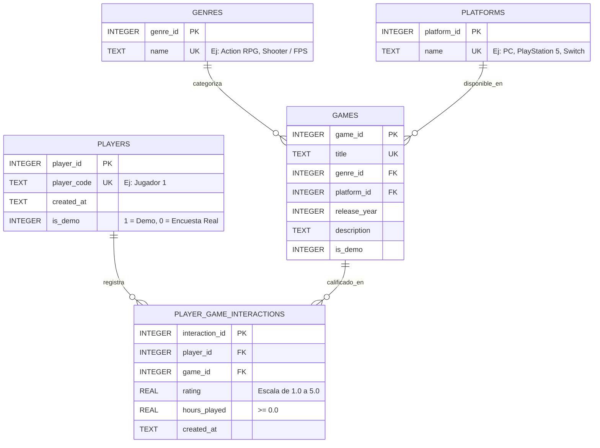

# GameSense: Sistema Inteligente de Recomendación de Videojuegos Basado en el Comportamiento del Jugador

**Corporación Universitaria Minuto de Dios - UNIMINUTO**  
*Facultad de Ingeniería — Programa de Ingeniería en Ciencia de Datos e Inteligencia Artificial (2026)*  
**Autores:** Julián Steban Pulido Santos, Didier Esteban Barbosa Albornoz  
**Asesor:** Víctor Andrés Hernández Arias  

---

## 📌 1. Descripción del Proyecto y Propósito del MVP

**GameSense** es un Producto Mínimo Viable (MVP) funcional diseñado para abordar la sobreoferta de videojuegos en el mercado actual, guiando al jugador mediante recomendaciones personalizadas basadas en su **comportamiento real histórico** (horas dedicadas, calificaciones otorgadas y plataformas preferidas) en lugar de listas genéricas de popularidad.

El proyecto implementa de manera tangible y demostrable las 3 fases de la propuesta académica:
1. **Estructuración de la información:** Base de datos relacional normalizada (SQLite) que almacena jugadores (anónimos bajo identificadores como `Jugador 1`), catálogo de videojuegos, géneros, plataformas e interacciones conductuales (calificación del 1 al 5 y horas aproximadas jugadas).
2. **Análisis exploratorio de datos (EDA):** Detección de patrones y hábitos de juego mediante KPIs (horas totales, calificación promedio, géneros dominantes y desgloses por plataforma).
3. **Inteligencia Artificial y Recomendación Explicable:** Motor de recomendación con ponderación conductual (Content-Based Filtering) que justifica de forma transparente y en lenguaje natural el porqué de cada sugerencia. Además, incluye un modelo de Filtrado Colaborativo para contrastar académicamente el impacto de la dispersión de datos (*sparsity*).

---

## 🔄 2. Flujo Completo del Sistema



---

## 🗃️ 3. Modelo de Datos Relacional

La base de datos relacional garantiza integridad referencial mediante llaves foráneas (`PRAGMA foreign_keys = ON`), restricciones de dominio y separación entre datos de muestra y datos reales:



---

## 🧠 4. Enfoque del Algoritmo de Recomendación

### 4.1. Filtrado Basado en Contenido con Ponderación Conductual (Principal)
Para cada jugador $u$ y género $g$, el peso conductual combina la satisfacción explícita ($r_{u, i}$) con el compromiso de tiempo atenuado logarítmicamente ($\ln(1 + h_{u, i})$):

$$W(u, g) = \sum_{i \in I_{u, g}} r_{u, i} \times \ln(1 + h_{u, i})$$

El vector de afinidad normalizado es:
$$A(u, g) = \frac{W(u, g)}{\sum_{k} W(u, k)}$$

Para cada título no jugado $j$ con género $g_j$ y plataforma $p_j$:
$$\text{Score}(u, j) = 0.70 \cdot A(u, g_j) + 0.30 \cdot P(u, p_j)$$

### 4.2. Explicabilidad Transparente
El sistema no es una caja negra. Cada recomendación viene acompañada de una justificación que cita los números exactos del jugador:
> *"Otorgaste una alta calificación promedio de 4.8/5.0 y acumulaste 120.0 horas (100% de tu tiempo) en títulos de Action RPG como 'The Witcher 3: Wild Hunt', 'Elden Ring'. El juego está disponible en tu plataforma frecuente (PC), donde registras 120.0 horas de juego."*

### 4.3. Filtrado Colaborativo y Reto de Dispersión (*Sparsity*)
El sistema implementa también *User-Based Collaborative Filtering* mediante similitud de cosenos entre usuarios con juegos comunes. En la interfaz se evidencia de forma pedagógica que, cuando los encuestados reportan pocos títulos (3 juegos por encuesta), la matriz de interacción es muy dispersa (*sparsity problem*), demostrando por qué el filtrado basado en contenido con ponderación conductual es la técnica más adecuada y robusta para esta fase del proyecto de grado.

---

## 📁 5. Estructura del Proyecto

```
Gamesense/
├── data/
│   ├── gamesense.db               # Base de datos SQLite activa
│   └── survey_template.csv        # Plantilla CSV para Google Forms
├── src/
│   ├── database/
│   │   ├── schema.sql             # DDL del esquema relacional
│   │   ├── db_manager.py          # Conexión, CRUD y persistencia
│   │   ├── sample_data.py         # Catálogo de 33 juegos y 5 perfiles demo
│   │   └── data_importer.py       # Importador de respuestas CSV
│   ├── analysis/
│   │   └── player_eda.py          # Métricas de comportamiento y agregaciones
│   ├── recommender/
│   │   ├── engine.py              # Algoritmos CBF y CF
│   │   └── explainer.py           # Generador de explicaciones en lenguaje natural
│   └── ui/
│       └── app.py                 # Dashboard interactivo en Streamlit
├── tests/
│   └── test_flow.py               # Prueba de integración automatizada del flujo
├── app.py                         # Punto de entrada raíz
├── requirements.txt               # Dependencias del proyecto
└── README.md                      # Documentación académica del sistema
```

---

## 🚀 6. Instrucciones de Instalación y Uso

### 6.1. Requisitos Previos
- Python 3.10 o superior (instalado con Windows Package Manager o instalador oficial).

### 6.2. Configuración del Entorno Virtual (Opcional si ya está creado)
```powershell
python -m venv .venv
.\.venv\Scripts\activate
pip install -r requirements.txt
```

### 6.3. Ejecución de la Aplicación Web Interactiva
Desde la carpeta raíz del proyecto, ejecuta:
```powershell
.\.venv\Scripts\streamlit.exe run app.py
```
O con el entorno activado:
```powershell
streamlit run app.py
```
Abre tu navegador en: **`http://localhost:8501`**

### 6.4. Ejecución de Pruebas Automatizadas
Para validar que todo el flujo (base de datos $\rightarrow$ análisis $\rightarrow$ recomendación $\rightarrow$ explicación) funciona al 100%:
```powershell
.\.venv\Scripts\python.exe tests\test_flow.py
```

---

## 📊 7. Integración con Encuestas de Google Forms

1. Realiza la encuesta solicitando: Código Jugador, Nombre Videojuego, Género, Plataforma, Calificación (1.0 a 5.0) y Horas jugadas.
2. Exporta las respuestas en formato `.csv` siguiendo la estructura de `data/survey_template.csv`:
   ```csv
   player_code,game_title,genre,platform,rating,hours_played
   Jugador 10,Baldur's Gate 3,Action RPG,PC,5.0,90
   ```
3. En la interfaz web de GameSense, ve a la pestaña **"📁 Importar Encuesta (Google Forms)"**, sube el archivo y haz clic en **"Procesar e Importar"**.
4. El sistema creará automáticamente los nuevos jugadores con bandera de encuesta real (`is_demo = 0`), actualizará el catálogo y generará sus recomendaciones inmediatamente.
